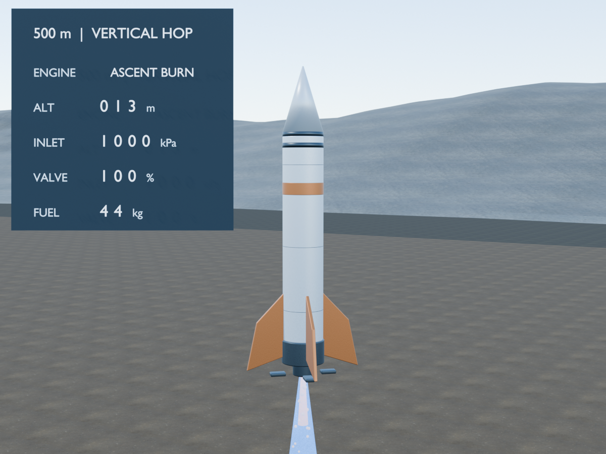

# CFD-informed nozzle control for a 500 m vertical hop



**A simulation demonstrator connecting compressible nozzle CFD, a physics-informed neural surrogate, reinforcement learning, and a simplified flight model.** The [final guided-landing render](animation/final/dqn_ascent_guided_descent.mp4) and [early DQN failure render](animation/final/early_dqn_failure.mp4) are 1440×1080 at 30 fps. They visualize saved simulator traces, not footage or a combustion simulation.

An [early DQN failure preview](animation/blender/rocket_hop_failed_step000000_draft.mp4) and [separate editable Blender scene](animation/blender/rocket_hop_failed_step000000.blend) show the saved zero-step policy overshooting the height target and contacting the ground too fast. The post-contact tip-over and dust are illustrative. Comparing this clip with the successful hybrid clip shows development progress, **not** that a pure DQN learned to land; the successful clip uses guided descent.

## Why this project exists

A nozzle calculation tells us how flow behaves at a chosen operating condition. A flight controller has a different question: **which inlet-pressure command should it issue now, as vehicle mass, speed, and ambient pressure change?** Running Fluent at every control decision is impractical, so this project tests a chain from CFD data to a fast nozzle model and then to control decisions.

The objective is deliberately small and measurable: command a simplified vehicle to rise about **500 m**, return at **no more than 5 m/s**, and retain **at least 5 kg** of propellant in the simulator. Holding attitude vertical isolates the pressure-control problem. We compare a learned policy with simple programmed control because a neural controller is useful only when its measured behavior justifies it.

The project is also an exercise in connecting models without hiding their boundaries: the PINN approximates the nozzle flow, the flight model supplies changing conditions, the DQN chooses discrete pressure actions, and a separate feedback rule handles final descent. Its contribution is the **integration and measured comparison**, not a claim to have designed a flight-ready reusable rocket.

## System at a glance

```text
Steady, axisymmetric Fluent cases (300 K air; 600–1000 kPa inlet)
                  │
                  ▼
Wall-aware PINN → predicted exit fields → mass-flow/thrust map
                                            │
                          altitude → ambient pressure
                                            │
                                            ▼
                                point-mass flight simulator
                                            ▲
                                DQN ascent commands
                                guided descent commands
                                            │
                                            ▼
                                saved traces → Blender
```

At each decision, the controller chooses **off, 600, 700, 800, 900, or 1000 kPa** inlet total pressure. The simulator updates altitude, vertical speed, fuel, and actuator state. It adjusts pressure thrust for the modelled ambient pressure; this adjustment assumes that ambient pressure does not change the internal nozzle solution.

## What was built

| Component | Current artifact | Role |
|---|---|---|
| CFD data | Nine field exports, 600–1000 kPa, plus wall and outlet data | Source conditions for the surrogate and checks |
| Nozzle surrogate | [PINN code and results](propulsion_pinn/README.md) | Predicts flow fields and supplies a provisional exit-performance map |
| Flight and control | [Flight-model code and results](flight_model/README.md) | Simulates the hop and compares DQN, hybrid, and programmed policies |
| Visualization | [Blender scene and build scripts](animation/blender/README.md) | Animates the saved trajectory with a tracking camera and telemetry panel |

The PINN was trained in stages with field-data, wall-boundary, continuity, and approximate momentum losses, followed by mass-consistency refinement. It does **not** enforce Fluent's complete compressible energy and SST turbulence equations.

## Measured results

The **950 kPa CFD field was withheld from PINN training and checkpoint selection**. Relative L2 errors against that Fluent field were **1.029%** for axial velocity, **2.346%** for radial velocity, **0.531%** for static pressure, and **0.277%** for static temperature. Direct linear interpolation between the 900 and 1000 kPa CFD fields was more accurate on this case. These are comparisons with CFD cell data, not experimental errors or thrust-validation errors. See the [independent test](propulsion_pinn/results/checkpoints/final/independent_950.json) and [PINN analysis](propulsion_pinn/FINAL_PINN_RESULTS.md).

For the **500 m** mission, a deterministic sweep over 21 initial masses from 99 to 101 kg gave:

| Policy | Meets height, touchdown, and fuel criteria | Mean peak-height error | Mean touchdown speed as % of 5 m/s limit |
|---|---:|---:|---:|
| DQN alone | 4.76% | 3.36% | 215.47% |
| **DQN ascent + guided descent** | **100%** | **3.36%** | **24.15%** |
| Timed ascent + same guided descent | 100% | **2.40%** | 28.25% |

The hybrid improves touchdown speed over the timed-ascent reference in this sweep, while the reference has lower mean height error. The DQN alone is **not** a reliable landing controller. This sweep was used during controller development, so it is not a strictly untouched test set. Full criteria and per-case results are in the [project status](flight_model/PROJECT_STATUS.md), [validation summary](flight_model/results/landing/final/validation_summary.json), and [case table](flight_model/results/landing/final/validation_cases.csv).

### Why the early attempt crashed — in plain language

Think of trying to stop a fast-moving car. Strong brakes do not help if they are applied with too little road left. In the [early DQN trace](flight_model/results/landing/seed0_v3/step000000_trace.csv), the rocket first rose to **621.20 m**, overshooting the 500 m target by **24.24%**. It then kept the engine off through most of the fall. The first descent braking command came at about **120 m**, when it was already falling at **98.21 m/s**. It commanded 900 kPa, but there was not enough height left to remove that speed. It hit at **75.11 m/s**, or **1502.12% of the allowed 5 m/s**.

The vehicle still had **21.06 kg of fuel** at impact. It did not fail because the tank was empty; the observed problem was **when it chose to brake**. Training included a fuel-use penalty, but the trace alone cannot tell us that the network was deliberately trying to conserve fuel. This “step 0” policy had already received demonstration-based pretraining, but had not yet taken reinforcement-learning environment steps. The later pure DQN improved height tracking but still failed the touchdown-speed limit. The successful visualized flight adds a separate guided-descent rule; it is **not** evidence that pure DQN learned a safe landing.

## Limits of the claim

- The CFD uses **300 K air**, not reacting rocket exhaust. The vehicle, drag, actuator, and atmosphere are educational assumptions. The animated plume is illustrative.
- The PINN-derived thrust map has **not** been independently validated against Fluent outlet-face integrated thrust. Supplied Fluent inlet/outlet mass-flow reports show **1.07–3.70% imbalance** across the reported 650–1000 kPa cases; the 750 kPa outlet profile lacks flow variables. See the [CFD outlet audit](flight_model/CFD_OUTLET_AUDIT.md).
- The varying-ambient-pressure correction changes the pressure-thrust term but does not recompute the nozzle flow. Shocks, separation, and regimes outside the sampled pressure range need further CFD work.
- The 21-case control sweep is simulator evidence, not a real-flight test. It does not establish robustness to all model errors, sensors, weather, or hardware delays.

**Appropriate description:** a *CFD-informed vertical-hop control demonstrator with a data-assisted, partially physics-informed nozzle surrogate*.

## Reproduce and inspect

1. Read [PINN setup and results](propulsion_pinn/README.md), then [flight-model setup](flight_model/README.md).
2. Inspect the frozen [nozzle performance map](propulsion_pinn/results/checkpoints/final/exit_performance.csv), [controller manifest](flight_model/results/landing/final/policy_manifest.json), and [nominal hybrid trace](flight_model/results/landing/final/dqn_ascent_guided_descent_nominal_trace.csv).
3. Open the [Blender 5.2 scene](animation/blender/rocket_hop_v04.blend) or watch the [draft video](animation/blender/rocket_hop_v04_draft.mp4). The scene packs its CC0 texture images; asset sources are listed in the [animation README](animation/blender/README.md).

The original Fluent ASCII exports are included in `data/raw/`, with file checksums in `PACKAGE_MANIFEST.csv`. Retraining the PINN uses `data/raw/fields`; the outlet and wall exports remain available for auditing. The selected checkpoints, performance map, flight traces, and visualization are also included.

## Repository contents

The raw data, code, saved checkpoints, flight traces, Blender scenes, final 1440×1080 videos, and SHA-256 checksums are included here. Intermediate render frames and unrelated internship files are excluded. No project license has been selected yet.
